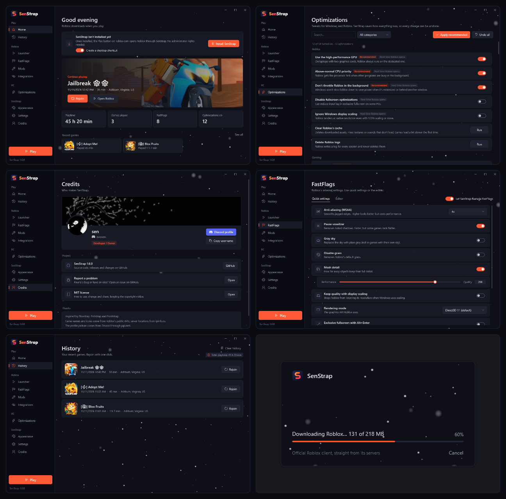

<p align="center">
  
</p>

<h1 align="center">SenStrap</h1>

<p align="center">
  An alternative Roblox launcher for Windows in the style of Bloxstrap, written from scratch in C# (.NET 10 + WPF).<br>
  <a href="https://github.com/Damian-code1/SenStrap/releases/latest"><b>⬇ Download the latest version</b></a>
</p>

SenStrap **doesn't modify the game**: it downloads the official Roblox client from Roblox's servers, applies your settings (FastFlags, mods and optimizations) and launches it.



## Download and install

1. Download **`SenStrap.exe`** from the [latest release](https://github.com/Damian-code1/SenStrap/releases/latest). It runs on 64-bit Windows 10 and 11 with nothing else to install.
2. Open it. Windows may show "Windows protected your PC" because the app isn't signed: click **More info**, then **Run anyway**.
3. Pick your language and click **Install SenStrap**.

## Features

- Registers itself as the handler for `roblox://` and `roblox-player:` links, so the **Play** button on roblox.com opens Roblox through SenStrap.
- Downloads and installs the latest Roblox version into `%LOCALAPPDATA%\SenStrap\Versions` and checks the MD5 hash of every package.
- **16 languages**, chosen the first time you open it (and in Settings): English, Español, Português (Brasil), Français, Deutsch, Italiano, Русский, Українська, Polski, Türkçe, Bahasa Indonesia, Filipino, Tiếng Việt, 日本語, 한국어 and 简体中文.
- **Optimizations**: 72 tweaks for Windows and Roblox in 10 categories (Roblox, gaming, mouse and keyboard, visual effects, privacy and ads, system, power, services, File Explorer and taskbar, cleanup).
  - Every change can be undone. Before changing anything, SenStrap saves how it was in `Tweaks.json`. **Undo all** puts back the exact previous values, including keys that didn't exist before.
  - **Apply recommended** turns on the 40 tweaks that are safe for everyone. Tweaks with side effects are marked **Read first**.
  - Roblox options are applied every time SenStrap opens Roblox: high-performance GPU, above-normal CPU priority, no power throttling in the background, fullscreen optimizations and display scaling.
  - Tweaks that change the whole PC (services, power plans, system policies) need administrator rights. Windows asks once per batch, and only those tweaks run elevated.
  - Badges tell you when a change applies (next time Roblox opens, after restarting Explorer or the PC). Explorer can be restarted from the page.
  - Cleanup: temporary files (older than a day), GPU shader caches, crash dumps, error reports, Roblox's cache and logs, and the DNS cache. Files in use are skipped.
- **FastFlags**:
  - Quick settings with toggles: MSAA, voxelizer, gray sky, grass, mesh detail (slider), DPI scaling, rendering mode, Alt+Enter, quality level and textures. All of them use Roblox's allowlist.
  - Table editor: search, add, import/export JSON, copy, delete, profiles, and a ⚠ warning on flags Roblox ignores.
- **Mods**: copies the files in `%LOCALAPPDATA%\SenStrap\Modifications` on top of Roblox. From the app you can set your own death sound (.ogg), cursor (.png) and Shift Lock icon (.png).
- **Launcher**:
  - Asks before closing a Roblox window that's already open.
  - Closes the Crash Handler.
  - Background updates: if there's a new version, Roblox opens right away with the one you have and the new one downloads while you play (SenStrap waits for it to finish before closing).
  - Automatic cleanup of old downloads and logs.
- **Integrations** (SenStrap stays in the system tray while you play):
  - Activity tracking by reading Roblox's logs.
  - Server location (looks up the server IP on ipinfo.io).
  - Playtime counter.
  - Game history with **Rejoin**.
  - Auto rejoin: if Roblox loses connection to the server (error 277, 266 or 279), it waits a few seconds in case it reconnects on its own; if not, it closes the disconnected Roblox and rejoins the same server. Never after a kick (267), the anti-cheat (268) or a session opened elsewhere (273). At most 3 times every 15 minutes.
- **Interface**:
  - Flat design with one accent color, a grouped sidebar with a **Play** button always at hand, and rounded window corners on Windows 11.
  - Home dashboard: your last game with its Roblox thumbnail and a **Rejoin** button, playtime, games played, FastFlags and optimizations at a glance, and your recent games.
  - No Save/Close bar in the way: a bar with **Save** and **Discard** only shows up when you have unsaved changes.
  - Snow falling behind the windows, with depth (small, dim flakes far away; large, soft ones up close), slow wind gusts and its own sway for every flake.
  - A short intro with the logo when SenStrap opens. Click or press any key to skip it.
  - Snow and the intro can be turned off in **Appearance**.
- **Credits** page with the developer's Discord profile.
- **Updates itself**: when it opens, SenStrap checks the latest GitHub release. If there's a newer version it shows *Downloading SenStrap…*, checks the file against the SHA-256 in the release notes, replaces only `SenStrap.exe` and opens again where you were (including a game you clicked on roblox.com). Settings, mods, FastFlags, optimizations and the installed Roblox are kept. Can be turned off in Settings.
- Creates shortcuts (the desktop one opens SenStrap) and shows up in *Settings > Apps* so it can be uninstalled.
- Only writes to `HKEY_CURRENT_USER` and `%LOCALAPPDATA%`, without administrator rights. The one exception is the machine-wide optimizations, which you apply yourself and which ask for permission first.

### What it intentionally doesn't do

- **Use your Roblox account cookie:** having that cookie is the same as having your account, so SenStrap never reads it. That's also why there's no region selector or *BetterMatchmaking*: knowing where each server is before joining would require that cookie.
- **SOCD or "Soft Key":** it would intercept everything you type and alter your key presses to gain a movement advantage. Many games consider it cheating.
- **Turn off security features:** no optimization touches Windows Defender, UAC, Windows Update, the firewall or CPU security mitigations.
- **Placebo tweaks:** registry values that "boost FPS" without doing anything (Nagle's algorithm for Roblox's UDP traffic, MMCSS "Games" priorities, `Win32PrioritySeparation` and the like) aren't included.

## Building from source

### Requirements

- 64-bit Windows 10 or 11.
- The **.NET 10 SDK**:

```bash
winget install Microsoft.DotNet.SDK.10
```

Then close and reopen the terminal and check it's installed:

```bash
dotnet --version
```

It should print a number starting with `10.`.

### Build and run

Run every command in this folder (where `SenStrap.sln` is).

Debug build:

```bash
dotnet build
```

Run the app without producing the final .exe:

```bash
dotnet run --project SenStrap
```

### Produce the .exe

```bash
dotnet publish SenStrap\SenStrap.csproj -c Release -o publish
```

This creates **`publish\SenStrap.exe`**: a single file (about 70 MB) that runs on any 64-bit Windows PC with nothing else installed. You can also double-click **`build.bat`**, which runs the same command.

If you'd rather have a small .exe (under 1 MB) that needs the *.NET 10 Desktop Runtime* installed on the PC where it runs:

```bash
dotnet publish SenStrap\SenStrap.csproj -c Release -o publish-lite -p:SelfContained=false
```

## Usage

1. Open `SenStrap.exe` and click **Install SenStrap**. It copies itself to `%LOCALAPPDATA%\SenStrap`.
2. Click **Play**, or go to roblox.com and press **Play** on any game.
3. The first time it downloads Roblox (about 230 MB). After that it only checks for a new version.
4. Optional: open **Optimizations** and click **Apply recommended**.

To uninstall: in SenStrap go to **Settings > Uninstall**, or use *Windows Settings > Apps*. When it's installed, SenStrap remembers which launcher used to open Roblox links (Froststrap, Bloxstrap, the official one...) and hands them back when it's uninstalled. If that launcher no longer exists, it uses the official Roblox one; if that's missing too, reinstall Roblox from roblox.com. If you applied optimizations, click **Undo all** in Optimizations before uninstalling to put Windows back as it was.

Note: Roblox only allows one window at a time. If you open a game with SenStrap while Roblox is already open, the open one closes.

## Project structure

| File | What it does |
|---|---|
| `App.xaml.cs` | Entry point: decides which window to open based on the arguments |
| `AppInfo.cs` | Name, version and folders |
| `Core/RobloxDeployment.cs` | Talks to Roblox's servers (current version and package list) |
| `Core/RobloxInstaller.cs` | Downloads, verifies and installs Roblox |
| `Core/Launcher.cs` | What happens when you press Play |
| `Core/FastFlags.cs` | Writes the FastFlags |
| `Core/Mods.cs` | Applies the mods |
| `Core/ProtocolHandler.cs` | Registers the `roblox://` and `roblox-player:` links |
| `Core/SelfInstaller.cs` | Installs and uninstalls SenStrap |
| `Core/Lang.cs` and `Resources/Languages/*.json` | Languages. To add one, copy `en.json`, translate it and add it to the list in `Lang.cs` |
| `Core/FastFlagCatalog.cs` | Roblox's allowlist and the quick-setting flags |
| `Core/ActivityWatcher.cs` | Activity tracking (reads Roblox's log) |
| `Core/GameHistory.cs` | History, game names and icons, and server location |
| `Core/Cleaner.cs`, `Core/Compatibility.cs` | Automatic cleanup and compatibility options |
| `Core/Tweaks/TweakCatalog.cs` | Every optimization, with its English and Spanish text |
| `Core/Tweaks/TweakTypes.cs` | Kinds of tweaks (registry values, services, power plans, cleanups...) and how each one is undone |
| `Core/Tweaks/TweakEngine.cs` | Applies and undoes tweaks; machine-wide ones run in an elevated copy of SenStrap (`-tweaks`) |
| `Core/Tweaks/LaunchTweaks.cs` | Roblox options applied on every launch (GPU, priority, power throttling) |
| `Core/Tweaks/Sys.cs` | Registry, commands and folders, with a test sandbox (`SENSTRAP_TWEAK_SANDBOX`) |
| `Core/AppUpdater.cs`, `UI/UpdateWindow.xaml` | Updates SenStrap from GitHub releases |
| `Core/OwnerProfile.cs` | The developer's Discord profile on the Credits page |
| `UI/TrayHost.cs` | System tray icon while you play |
| `UI/WelcomeWindow.xaml` | Welcome screen with language selection |
| `UI/MainWindow.xaml` | Main window: intro, title bar, sidebar, bottom bar and toasts |
| `UI/Pages/` | The pages: Home, Launcher, Integrations, History, Optimizations, FastFlags, Mods, Appearance, Settings and Credits |
| `UI/BootstrapperWindow.xaml` | Loading window with the progress bar |
| `UI/Controls/Snowfall.cs` | The snow |
| `UI/Controls/SettingRow.cs` | Reusable settings row (icon, title, description and control) |
| `UI/Theme.xaml` | Colors, buttons, toggles, dropdowns and other styles |
| `Resources/` | Icon, logos and the Credits pictures |

## Good to know

- **FastFlags:** Roblox only accepts the flags on its allowlist and ignores the rest.
- **No code injection and no touching the game's memory.** SenStrap only downloads official files and writes configuration; that's what keeps it safe.
- **Antivirus and SmartScreen:** a new unsigned .exe may trigger warnings when shared. Publishing the source on GitHub and building it with GitHub Actions helps people trust it.
- If Roblox adds a new package, SenStrap tries to guess where it goes and writes it to the log. To handle it properly, add it to `PackageMap` in `Core/RobloxDeployment.cs`.
- The Credits page refreshes the developer's Discord name and picture at most once a day (from japi.rest and Discord's CDN). If that fails, it shows the copy included in the app.
- Logs are in `%LOCALAPPDATA%\SenStrap\Logs`.

## Ideas for later

- Discord Rich Presence: requires creating your own application in the Discord Developer Portal.
- Building the .exe automatically with GitHub Actions on every release.

## Credits

Developer / Owner: **evosen.** on [Discord](https://discord.com/users/1407737422732853331).

## License

[MIT](LICENSE). You can use, modify and share the code as long as you keep the copyright notice.

SenStrap is not affiliated with Roblox Corporation. Roblox is a trademark of Roblox Corporation.
