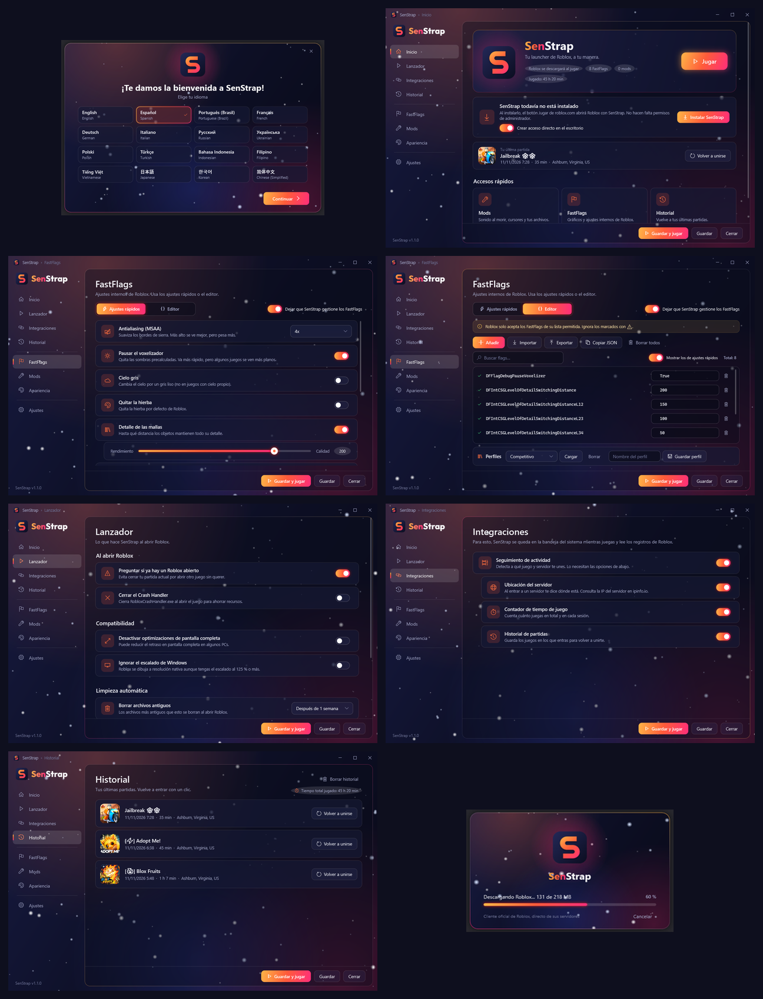

<p align="center">
  
</p>

<h1 align="center">SenStrap</h1>

<p align="center">
  Launcher alternativo para Roblox en Windows, del estilo de Bloxstrap, escrito desde cero en C# (.NET 10 + WPF).<br>
  <a href="https://github.com/Damian-code1/SenStrap/releases/latest"><b>⬇ Descargar la última versión</b></a>
</p>

SenStrap **no modifica el juego**: descarga el cliente oficial de Roblox desde los servidores de Roblox, le aplica tus ajustes (FastFlags y mods) y lo abre.



## Descargar e instalar

1. Descarga **`SenStrap.exe`** de la [última release](https://github.com/Damian-code1/SenStrap/releases/latest). Funciona en Windows 10 y 11 de 64 bits sin instalar nada más.
2. Ábrelo. Windows puede avisar con "Windows protegió su PC" porque el programa no está firmado: pulsa **Más información** y luego **Ejecutar de todas formas**.
3. Elige tu idioma y pulsa **Instalar SenStrap**.

## Qué hace

- Se registra como el programa que abre los enlaces `roblox://` y `roblox-player:`. Así, el botón **Jugar** de roblox.com abre Roblox a través de SenStrap.
- Descarga e instala la última versión de Roblox en `%LOCALAPPDATA%\SenStrap\Versions` y comprueba el MD5 de cada paquete.
- **16 idiomas**, que se eligen al abrirlo por primera vez (y en Ajustes): English, Español, Português (Brasil), Français, Deutsch, Italiano, Русский, Українська, Polski, Türkçe, Bahasa Indonesia, Filipino, Tiếng Việt, 日本語, 한국어 y 简体中文.
- **FastFlags**:
  - Ajustes rápidos con interruptores: MSAA, voxelizador, cielo gris, hierba, detalle de mallas (deslizador), escalado DPI, modo de renderizado, Alt+Enter, nivel de calidad y texturas. Todos usan la lista permitida de Roblox.
  - Editor en tabla: búsqueda, añadir, importar y exportar JSON, copiar, borrar, perfiles y aviso ⚠ en los flags que Roblox ignora.
- **Mods**: copia los archivos de `%LOCALAPPDATA%\SenStrap\Modifications` encima de Roblox. Desde la app puedes poner tu propio sonido al morir (.ogg), cursor (.png) e icono de Shift Lock (.png).
- **Lanzador**:
  - Confirmar si ya hay un Roblox abierto.
  - Cerrar el Crash Handler.
  - Actualizaciones en segundo plano: si hay versión nueva, Roblox se abre al momento con la que ya tienes y la nueva se descarga mientras juegas (SenStrap espera a que termine antes de cerrarse).
  - Compatibilidad: optimizaciones de pantalla completa y escalado DPI.
  - Limpieza automática de descargas y registros antiguos.
- **Integraciones** (SenStrap se queda en la bandeja del sistema mientras juegas):
  - Seguimiento de actividad leyendo los registros de Roblox.
  - Ubicación del servidor (consulta su IP en ipinfo.io).
  - Contador de tiempo de juego.
  - Historial de partidas con **Volver a unirse**.
  - Reconexión automática: si Roblox pierde la conexión con el servidor (errores 277, 266 o 279), espera unos segundos por si se reconecta solo y, si no, cierra el Roblox desconectado y vuelve a entrar al mismo servidor. Nunca tras una expulsión (267), el anti-trampas (268) o una sesión abierta en otro sitio (273). Como mucho 3 veces cada 15 minutos.
- **Interfaz animada**:
  - Aurora de colores y partículas a elegir (**nieve**, **brasas**, **estrellas** o ninguna) que se apartan del ratón.
  - Bordes con brillo que gira, pestañas con indicador deslizante, transiciones en cascada y una ventana de carga con el logo flotando.
  - Todo se puede desactivar en **Apariencia**.
- Crea accesos directos (el del escritorio abre SenStrap) y aparece en *Configuración > Aplicaciones* para poder desinstalarlo.
- No necesita permisos de administrador: solo escribe en `HKEY_CURRENT_USER` y en `%LOCALAPPDATA%`.

### Lo que no incluye a propósito

- **Usar la cookie de tu cuenta de Roblox:** tener esa cookie equivale a tener tu cuenta, así que SenStrap no la lee. Por eso tampoco tiene selector de región ni *BetterMatchmaking*: para saber dónde está cada servidor antes de entrar haría falta esa cookie.
- **SOCD o "Soft Key":** interceptaría todo lo que tecleas y alteraría tus pulsaciones para tener ventaja de movimiento. Muchos juegos lo consideran trampa.

## Requisitos para compilar

- Windows 10 u 11 de 64 bits.
- El **SDK de .NET 10**:

```bash
winget install Microsoft.DotNet.SDK.10
```

Después cierra y vuelve a abrir la terminal, y comprueba que está instalado:

```bash
dotnet --version
```

Tiene que salir un número que empiece por `10.`.

## Compilar y probar

Todos los comandos se ejecutan en esta carpeta (donde está `SenStrap.sln`).

Compilar en modo desarrollo:

```bash
dotnet build
```

Abrir la app sin generar el .exe final:

```bash
dotnet run --project SenStrap
```

## Generar el .exe

```bash
dotnet publish SenStrap\SenStrap.csproj -c Release -o publish
```

Genera **`publish\SenStrap.exe`**: un único archivo (unos 70 MB) que funciona en cualquier PC con Windows de 64 bits, sin instalar nada más. También puedes hacer doble clic en **`compilar.bat`**, que ejecuta ese mismo comando.

Si prefieres un .exe pequeño (menos de 1 MB) que necesite el *.NET 10 Desktop Runtime* instalado en el PC donde se use:

```bash
dotnet publish SenStrap\SenStrap.csproj -c Release -o publish-ligero -p:SelfContained=false
```

## Usarlo

1. Abre `SenStrap.exe` y pulsa **Instalar SenStrap**. Se copia a `%LOCALAPPDATA%\SenStrap`.
2. Pulsa **Jugar Roblox**, o entra en roblox.com y dale a **Jugar** en cualquier juego.
3. La primera vez descarga Roblox (unos 230 MB). Las siguientes veces solo comprueba si hay versión nueva.

Para desinstalarlo: en SenStrap ve a **Ajustes > Desinstalar**, o en *Configuración de Windows > Aplicaciones*. Al instalarse, SenStrap guarda qué launcher abría antes los enlaces de Roblox (Froststrap, Bloxstrap, el oficial...) y al desinstalarse se los devuelve. Si ese launcher ya no existe, usa el oficial de Roblox; si tampoco está, reinstala Roblox desde roblox.com.

Ojo: Roblox solo deja abrir una ventana a la vez. Si abres un juego con SenStrap mientras ya tienes Roblox abierto, se cierra el que estaba abierto.

## Estructura del código

| Archivo | Para qué sirve |
|---|---|
| `App.xaml.cs` | Punto de entrada: decide qué ventana abrir según los argumentos |
| `AppInfo.cs` | Nombre, versión y carpetas |
| `Core/RobloxDeployment.cs` | Habla con los servidores de Roblox (versión actual y lista de paquetes) |
| `Core/RobloxInstaller.cs` | Descarga, comprueba e instala Roblox |
| `Core/Launcher.cs` | Lo que pasa al darle a Jugar |
| `Core/FastFlags.cs` | Escribe los FastFlags |
| `Core/Mods.cs` | Aplica los mods |
| `Core/ProtocolHandler.cs` | Registra los enlaces `roblox://` y `roblox-player:` |
| `Core/SelfInstaller.cs` | Instala y desinstala SenStrap |
| `Core/Lang.cs` y `Resources/Languages/*.json` | Idiomas. Para añadir uno, copia `en.json`, tradúcelo y añádelo a la lista de `Lang.cs` |
| `Core/FastFlagCatalog.cs` | Lista permitida de Roblox y flags de los ajustes rápidos |
| `Core/ActivityWatcher.cs` | Seguimiento de actividad (lee el log de Roblox) |
| `Core/GameHistory.cs` | Historial, nombres e iconos de juegos y ubicación del servidor |
| `Core/Cleaner.cs`, `Core/Compatibility.cs` | Limpieza automática y opciones de compatibilidad |
| `UI/TrayHost.cs` | Icono en la bandeja mientras juegas |
| `UI/WelcomeWindow.xaml` | Bienvenida con selección de idioma |
| `UI/MainWindow.xaml` | Ventana principal: barra de título, menú lateral, barra inferior y avisos |
| `UI/Pages/` | Las páginas: Inicio, Lanzador, Integraciones, Historial, FastFlags, Mods, Apariencia y Ajustes |
| `UI/BootstrapperWindow.xaml` | Ventana de carga con el logo y la barra de progreso |
| `UI/Controls/ParticleCanvas.cs` | Las partículas animadas (nieve, brasas, estrellas) |
| `UI/Controls/AnimatedBackground.xaml` | Fondo azul noche con aurora y partículas |
| `UI/Controls/SettingRow.cs` | Fila de ajuste reutilizable (icono, título, descripción y control) |
| `UI/Anim.cs` | Animaciones de entrada, flotar y latir |
| `UI/Theme.xaml` | Colores, botones, interruptores, desplegables y demás estilos |
| `Resources/` | Icono y logos |

## Cosas a tener en cuenta

- **FastFlags:** Roblox solo acepta los flags de su lista permitida y el resto los ignora.
- **Nada de inyectar código ni tocar la memoria del juego.** SenStrap solo descarga archivos oficiales y escribe configuración; eso es lo que lo mantiene seguro.
- **Antivirus y SmartScreen:** un .exe nuevo sin firmar puede dar avisos al compartirlo. Publicar el código en GitHub y compilarlo con GitHub Actions ayuda a que la gente se fíe.
- Si Roblox añade un paquete nuevo, SenStrap intenta adivinar dónde va y lo apunta en el log. Para dejarlo bien, añádelo a `PackageMap` en `Core/RobloxDeployment.cs`.
- Los registros (logs) están en `%LOCALAPPDATA%\SenStrap\Logs`.

## Ideas para más adelante

- Estado en Discord (Rich Presence): necesitas crear tu propia aplicación en el portal de desarrolladores de Discord.
- Que SenStrap se actualice solo desde las *releases* de GitHub.
- Compilar el .exe automáticamente con GitHub Actions en cada release.

## Licencia

[MIT](LICENSE). Puedes usar, modificar y compartir el código citando el aviso de copyright.

SenStrap no está afiliado a Roblox Corporation. Roblox es una marca de Roblox Corporation.
